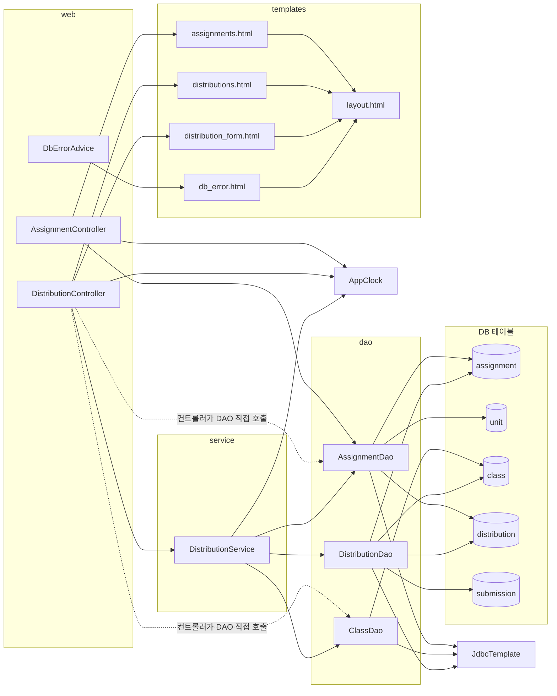

# legacy/assignment-thymeleaf 아키텍처

> 분석 범위: 진입점, 의존 관계. 데이터 흐름과 비즈니스 규칙은 아직 분석하지 않았다.
> 경로 약어: `J/` = `legacy/assignment-thymeleaf/src/main/java/com/example/assign/`,
> `T/` = `legacy/assignment-thymeleaf/src/main/resources/templates/`

## 1. 모듈 개요

- 과제 배포 관리 웹 앱이다. 버전 1.4.2 (`build.gradle:8`, `T/layout.html:35`).
- Spring Boot 3.3.4, Java 17 (`build.gradle:3,11-12`)
- 의존성은 web, Thymeleaf(서버 렌더링), JDBC(`JdbcTemplate`), MariaDB 드라이버다. JPA는 쓰지 않는다 (`build.gradle:25-28`).
- 포트 8080, 기본 DB는 `jdbc:mariadb://localhost:3306/itembank` (`application.properties:1-2`)
- 구조는 Controller → Service → DAO → 테이블이지만, 컨트롤러가 DAO를 직접 부르는 경로도 있다.

## 2. 폴더 구조

```
legacy/assignment-thymeleaf/
├── build.gradle · settings.gradle · Dockerfile
├── gradle/wrapper/ · gradlew · gradlew.bat          (분석 제외: 표준 래퍼)
└── src/
    ├── main/java/com/example/assign/
    │   ├── AssignApplication.java                    부트 진입점 (12줄)
    │   ├── AppClock.java                             현재 시각 static 유틸 (28줄)
    │   ├── web/
    │   │   ├── AssignmentController.java             (35줄)
    │   │   ├── DistributionController.java           (101줄)
    │   │   └── DbErrorAdvice.java                    DB 예외 전역 처리 (18줄)
    │   ├── service/
    │   │   └── DistributionService.java              (701줄, 모듈 소스의 약 44%)
    │   ├── dao/
    │   │   ├── AssignmentDao.java                    (66줄)
    │   │   ├── ClassDao.java                         (42줄)
    │   │   └── DistributionDao.java                  (108줄)
    │   └── model/
    │       └── AssignmentRow · ClassRow · DistributionRow · SubmissionRow · RedistributeResult (내부 미확인)
    ├── main/resources/
    │   ├── application.properties
    │   └── templates/
    │       └── layout · assignments · distributions · distribution_form · db_error (.html)
    └── test/java/com/example/assign/
        └── AppClockTest.java                         유일한 테스트 (20줄, 내용 미확인)
```

## 3. 진입점 표

| URL / 화면 | 처음 실행되는 파일 | 그 파일이 부르는 주요 함수 | 응답 |
|---|---|---|---|
| (앱 기동) | `J/AssignApplication.java:9-10` | `SpringApplication.run` | 포트 8080 (`application.properties:1`) |
| `GET /` | `J/web/AssignmentController.java:21-23` | 없음 | `/assignments` 로 리다이렉트 (`:23`) |
| `GET /assignments` 과제 목록 | `J/web/AssignmentController.java:26-33` | `AssignmentDao.findAllForList()` (`:28`), `AppClock.now()` (`:29`) | `T/assignments.html` (`:33`) |
| `GET /distributions` 배포 목록 | `J/web/DistributionController.java:32-37` | `DistributionService.listAll()` (`:34`), `AppClock.now()` (`:35`) | `T/distributions.html` (`:37`) |
| `GET /distributions/new` 새 배포 | `J/web/DistributionController.java:40-46` | `AssignmentDao.findAllForSelect()` (`:42`), `ClassDao.findAll()` (`:43`), `AppClock.now()` (`:44`) | `T/distribution_form.html` (`:46`) |
| `POST /distributions` 배포 등록 | `J/web/DistributionController.java:49-77` | `AssignmentDao.findById` (`:53`), `AppClock.now/fmt` (`:58,62`), `DistributionService.distribute` (`:67`) | `/distributions` 또는 `/distributions/new` 로 리다이렉트 (`:56,63,71,74,76`) |
| `POST /distributions/{id}/redistribute` 재배포 | `J/web/DistributionController.java:79-100` | `DistributionService.redistribute` (`:86`) | `/distributions` 로 리다이렉트 (`:89,99`) |
| DB 예외 (전역) | `J/web/DbErrorAdvice.java:11-16` | `DataAccessException` 을 처리하고 `System.out.println` 으로 출력 (`:13`) | `T/db_error.html` (`:16`) |

화면과 폼의 연결:

- 새 배포 폼은 `POST /distributions` 로 `assignmentId`, `classId` 를 보낸다 (`T/distribution_form.html:8,11,23`).
- 재배포 폼은 `POST /distributions/{id}/redistribute` 로 `reason` 과 숨은 필드 `operator` 를 보낸다. `operator` 값은 `teacher-01` 로 고정돼 있다 (`T/distributions.html:31,33-34`).
- 메뉴 링크 3개는 `T/layout.html:24-26` 에 있다.

## 4. 의존 관계

### 4.1 흐름도



### 4.2 호출 표 (A → B: A가 B를 호출하거나 포함)

**Java**

| A → B | 근거 | 비고 |
|---|---|---|
| `AssignmentController` → `AssignmentDao` | `J/web/AssignmentController.java:15,28` | 컨트롤러가 DAO를 직접 씀 |
| `AssignmentController` → `AppClock` | `J/web/AssignmentController.java:29` | |
| `DistributionController` → `DistributionService` | `J/web/DistributionController.java:22,34,67,86` | |
| `DistributionController` → `AssignmentDao` | `J/web/DistributionController.java:23,42,53` | 컨트롤러가 DAO를 직접 씀 |
| `DistributionController` → `ClassDao` | `J/web/DistributionController.java:24,43` | 컨트롤러가 DAO를 직접 씀 |
| `DistributionController` → `AppClock` | `J/web/DistributionController.java:35,44,58,62` | |
| `DistributionService` → `DistributionDao` | `J/service/DistributionService.java:39,43,59,62,63,153,348,620,631` | |
| `DistributionService` → `AssignmentDao` | `J/service/DistributionService.java:48,164` | |
| `DistributionService` → `ClassDao` | `J/service/DistributionService.java:52,239` | |
| `DistributionService` → `AppClock` | `J/service/DistributionService.java:63,77,304,426,665` | |
| `AssignmentDao` → `JdbcTemplate` | `J/dao/AssignmentDao.java:15` | |
| `ClassDao` → `JdbcTemplate` | `J/dao/ClassDao.java:14` | |
| `DistributionDao` → `JdbcTemplate` | `J/dao/DistributionDao.java:17` | |

**DAO → 테이블** (SQL 문자열 기준)

| A → B | 근거 |
|---|---|
| `AssignmentDao` → `assignment`, `unit`, `distribution` | `J/dao/AssignmentDao.java:22-24` |
| `ClassDao` → `class` | `J/dao/ClassDao.java:21,25` |
| `DistributionDao` → `distribution`, `assignment`, `class`, `submission` | `J/dao/DistributionDao.java:24-29,49,55,61,66,71` |

**템플릿 포함 관계**

| A → B | 근거 | 비고 |
|---|---|---|
| `assignments.html` → `layout.html` (`head`, `nav`, `flash`, `footer`) | `T/assignments.html:3,5,7,34` | |
| `distributions.html` → `layout.html` (`head`, `nav`, `flash`, `footer`) | `T/distributions.html:3,5,7,44` | |
| `distribution_form.html` → `layout.html` (`head`, `nav`, `flash`, `footer`) | `T/distribution_form.html:3,5,7,32` | |
| `db_error.html` → `layout.html` (`head`, `nav`, `footer`) | `T/db_error.html:3,5,9` | `flash` 는 포함하지 않음 |
| (조각 정의 위치) | `T/layout.html:3,23,28,35` | |

### 4.3 구조상 눈에 띄는 점

- 같은 검사를 두 번 한다. `AssignmentDao.findById` 와 "없으면 에러" 처리가 컨트롤러(`J/web/DistributionController.java:53-57`)와 서비스(`J/service/DistributionService.java:48-51`)에 모두 있다.
- `DistributionService.get()` (`J/service/DistributionService.java:42-44`) 을 호출하는 곳은 읽은 Java 파일 중에 없다.
- `AppClock` 은 빈이 아니라 static 유틸이다. `now()` 는 시스템 속성 `app.clock=system` 이 아니면 `2026-09-15 00:00:00` 고정값을 돌려준다 (`J/AppClock.java:9,14-19`).

## 5. 가장 긴 함수 3개

| 순위 | 파일 | 함수 | 시작–끝 | 길이 | 하는 일 |
|---|---|---|---|---|---|
| 1 | `J/service/DistributionService.java` | `redistribute(long, String, String)` | 72–700 | 629줄 | 입력 정리, 과제 상태·마감 판정, 제출 통계를 계산하고 재배포 플래그를 갱신한 뒤 결과 메시지를 만듦 |
| 2 | `J/web/DistributionController.java` | `create(long, long, RedirectAttributes)` | 50–77 | 28줄 | 과제 존재와 마감을 확인한 뒤 `distribute` 를 부르고 예외를 flash 메시지로 바꿈 |
| 3 | `J/service/DistributionService.java` | `distribute(long, long)` | 47–68 | 22줄 | 과제·학급 존재, 삭제 상태, 중복 배포를 검사하고 `MAX(id)+1` 로 id를 정해 insert |

- 시작 줄은 선언부 기준이고 어노테이션은 뺐다. 4위는 `DistributionController.redistribute` (80–100, 21줄).
- `redistribute` 하나가 서비스 파일 701줄 중 629줄(약 90%)이다. 함수 안은 `// ---------- 0.` ~ `// ---------- 11.` 주석으로 12개 구간으로 나뉜다 (`J/service/DistributionService.java:81,152,163,238,264,307,347,483,515,588,619,641`).

## 6. 미확인 목록

- `J/model/*.java` 5개(`AssignmentRow`, `ClassRow`, `DistributionRow`, `SubmissionRow`, `RedistributeResult`)의 내부
- `src/test/java/com/example/assign/AppClockTest.java` 의 내용
- 템플릿 5개에서 include, 링크, 폼, 반복, flash 바인딩 줄을 뺀 나머지 부분
- `DistributionService.get()` 을 템플릿이나 테스트에서 쓰는지
- `Dockerfile`, `settings.gradle` 의 내용
- 데이터 흐름과 비즈니스 규칙 (다음 단계에서 분석)
