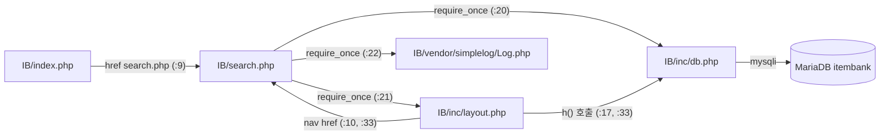

# item-bank — 문항 검색 화면 아키텍처

> 코드가 하는 일을 적은 후보이며 의도된 정책인지는 확인하지 않았다.

## 분석 범위

- 대상 모듈: `legacy/item-bank-php` (PHP 7.4 + Apache, mysqli, MariaDB)
- 대상 화면: **문항 검색(`search.php`) 한 화면**과 그 화면이 `require_once` 로 부르는 코드
  - `inc/db.php`, `inc/layout.php`, `vendor/simplelog/Log.php`
  - DB 객체: 뷰 `v_item_public`, 테이블 `unit` · `tag` · `item_tag`(와 뷰가 읽는 `item`)
- 범위 밖: `register.php`(문항 등록), `units.php`(단원 목록). `index.php` 는 메뉴 링크만 있어 진입 경로로만 적는다.
  - 처음 계획에서는 `index.php` 를 대상 화면으로 잡았으나, 메뉴 링크 3개뿐이라 규칙이 없고 링크를 따라가면 세 화면이 모두 범위에 들어가서 `search.php` 로 바꿨다.

## 경로 약어

| 약어 | 실제 경로 |
|---|---|
| `IB/` | `legacy/item-bank-php/` |
| `SCH` | `db/mariadb/init/01-schema.sql` |
| `SEED` | `db/mariadb/init/02-seed.sql` |

---

## 1. 진입점

| 경로 | 메서드 | 처리 파일:줄 | 설명 |
|---|---|---|---|
| `/search.php` | GET (`$_GET` 만 읽는다) | `IB/search.php:709-731` (실행부) | 문항 검색. 폼 · 결과 표 · 페이지 링크를 한 응답으로 그린다 |
| `/index.php` | GET | `IB/index.php:9` | 메뉴 링크 `<a href="search.php">` — 검색 화면으로 들어오는 경로 |
| (모든 화면 머리말) | — | `IB/inc/layout.php:10`, `:31-34` | 상단 nav 의 `search.php` 링크 |
| `/search.php?…` (자기 자신) | GET | `IB/search.php:632` (폼), `:414-416` (정렬 링크), `:690-700` (페이지 링크), `:639` (초기화) | 검색 조건 · 정렬 · 페이지 이동은 모두 자기 자신으로 다시 GET 한다 |

- GET 파라미터: `q`, `unit`, `level`, `tag`, `sort`, `dir`, `page` (`IB/search.php:5-12` 주석, 실제 읽기는 `:53-80`). 배열로 들어오면 첫 값만 쓴다(`:55` 등).
- `POST` 로 호출해도 본문은 읽지 않고 쿼리 문자열(`$_GET`)만 쓴다(`IB/search.php:722`).
- 스케줄러 · 배치 · API 엔드포인트: 이 범위에 없음.
- 로그인 · 세션 · 권한 검사: 이 화면에 없음(`session_start` · 인증 코드 없음).

---

## 2. 의존 관계

### 2.1 파일 간 호출 방향 (호출 줄로 확인)

| 호출하는 쪽 | 호출되는 쪽 | 호출 줄 |
|---|---|---|
| `IB/search.php` 실행부 | `render_header('문항 검색', 'search')` (`IB/inc/layout.php:7`) | `IB/search.php:709` |
| `IB/search.php` 실행부 | `db_connect()` (`IB/inc/db.php:7`) | `IB/search.php:713` |
| `IB/search.php` 실행부 | `buildSearchQuery($_GET, $conn)` (`IB/search.php:42`) | `IB/search.php:722` |
| `IB/search.php` 실행부 | `renderSearchForm($built)` (`IB/search.php:629`) | `IB/search.php:723` |
| `IB/search.php` 실행부 | `runSearchQuery($built, $conn)` (`IB/search.php:571`) | `IB/search.php:724` |
| `IB/search.php` 실행부 | `renderResultTable($built, $result)` (`IB/search.php:647`) | `IB/search.php:725` |
| `IB/search.php` 실행부 | `render_footer()` (`IB/inc/layout.php:38`) | `IB/search.php:717`, `:731` |
| `buildSearchQuery` | DB 직접 조회 (`unit` 이름, `unit` 목록, `tag` 목록) | `IB/search.php:125`, `:156`, `:178` |
| `runSearchQuery` | DB 조회 (`v_item_public` 건수 · 행) | `IB/search.php:577`, `:600` |
| `search.php` 전반 | `h()` (`IB/inc/db.php:34`) | `IB/search.php:360`, `:416`, `:457-459` 등 다수 |
| `search.php` | `Log::setThreshold` · `Log::debug` · `Log::error` | `IB/search.php:27`, `:103`, `:528`, `:537`, `:727` |
| `IB/inc/layout.php` | `h()` (`IB/inc/db.php:34`) | `IB/inc/layout.php:17`, `:33` |

- 계층 구분이 없다. 입력 해석 · SQL 조립 · 선택 목록 조회 · HTML 조각 생성이 모두 `buildSearchQuery` 한 함수(`IB/search.php:42-564`) 안에 있다. `runSearchQuery` 는 실행만, `render*` 는 출력만 한다.
- `IB/inc/layout.php` 는 `h()` 를 쓰지만 `inc/db.php` 를 스스로 include 하지 않는다. 호출하는 페이지가 `inc/db.php` 를 먼저 include 해야 동작한다(`IB/search.php:20-21` 순서).
- 실행 순서: 폼 출력(`:723`)이 쿼리 실행(`:724`)보다 먼저라서, 검색 쿼리가 실패해도 폼은 이미 출력되어 있다.

### 2.2 외부 의존

| 대상 | 내용 | 근거 |
|---|---|---|
| MariaDB `itembank` | 접속 정보는 환경 변수 `DB_HOST`·`DB_PORT`·`DB_NAME`·`DB_USER`·`DB_PASS`. 없으면 `mariadb:3306/itembank`, `app`/`app-pass` | `IB/inc/db.php:14-18` |
| 연결 방식 | 요청마다 한 번 연결(함수 내부 `static` 캐시), `utf8mb4`, `mysqli_report(MYSQLI_REPORT_OFF)` 로 예외 대신 반환값 검사 | `IB/inc/db.php:9-12`, `:20`, `:27` |
| DB 객체 | 뷰 `v_item_public`, 테이블 `unit`, `tag`, `item_tag` (뷰 내부에서 `item`) | `IB/search.php:522`, `:125`, `:156`, `:178`, `:244`; `SCH:52-70` |
| 콜레이션 | 모든 테이블 `utf8mb4_unicode_ci`(대소문자 구분 없음) — 문자열 비교 결과에 영향 | `SCH:5`, `:18`, `:33`, `:40`, `:48` |
| 라이브러리 | `SimpleLog\Log`(저장소에 포함된 더미 외부 라이브러리). `error_log` 로만 기록, 임계값 INFO 로 설정되어 `debug` 는 남지 않는다 | `IB/vendor/simplelog/Log.php:3-4`, `:43-52`; `IB/search.php:27` |
| PHP 확장 | `mysqli`(Dockerfile 에서 설치). `mbstring`(`mb_strlen`·`mb_substr`)은 Dockerfile 에 설치 줄이 없다 — `php:7.4-apache` 기본 이미지에 들어 있는 것으로 추정 | `IB/Dockerfile:1`, `:3`; `IB/search.php:26`, `:86-87` |
| 런타임 설정 | `display_errors = Off`, `error_log = /proc/self/fd/2` (컨테이너 stderr) | `IB/Dockerfile:7-12` |
