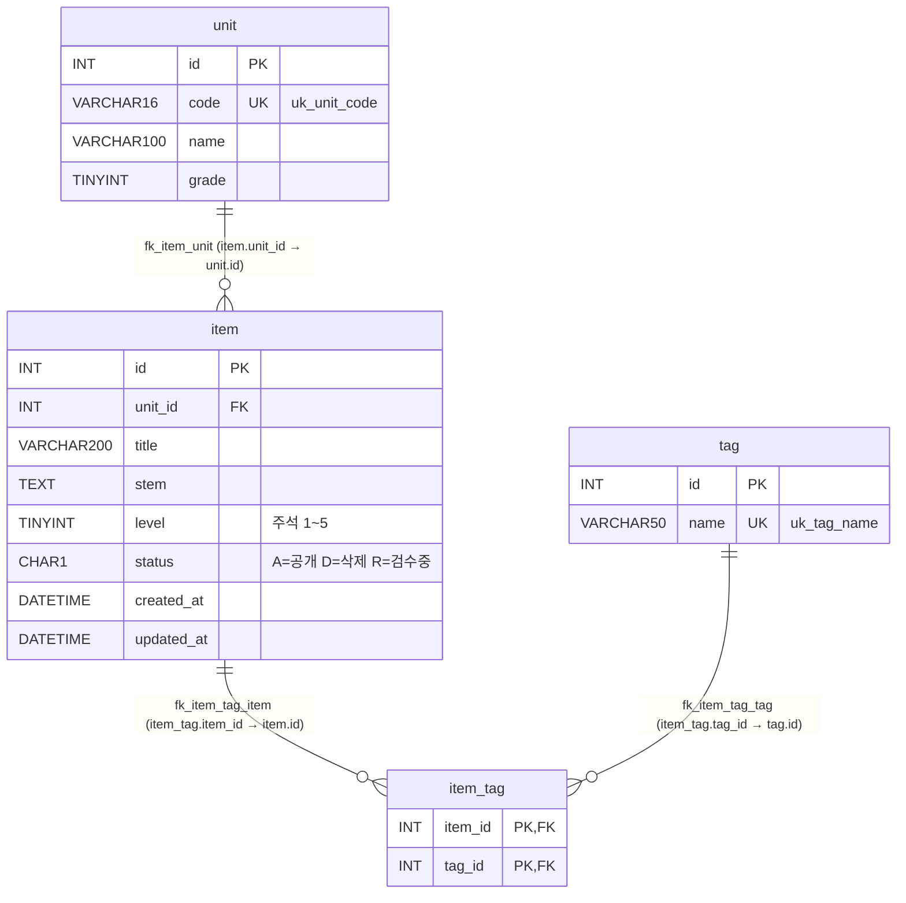
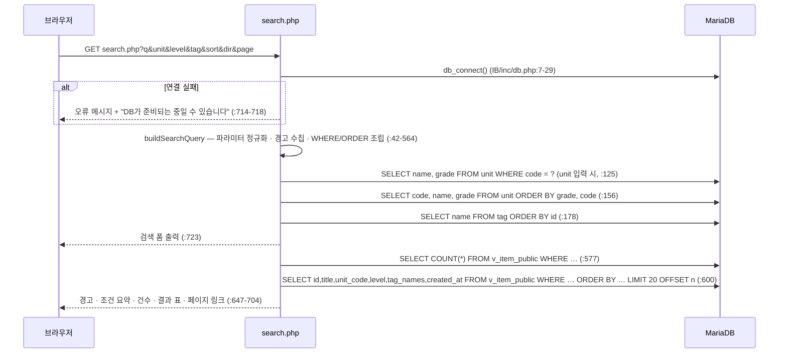

# item-bank — 문항 검색 화면 데이터 흐름 · ERD

> 코드가 하는 일을 적은 후보이며 의도된 정책인지는 확인하지 않았다.

- 분석 범위: `IB/search.php` 와 그 화면이 부르는 `IB/inc/db.php` · `IB/inc/layout.php` · `IB/vendor/simplelog/Log.php`
- 경로 약어: `IB/` = `legacy/item-bank-php/`, `SCH` = `db/mariadb/init/01-schema.sql`, `SEED` = `db/mariadb/init/02-seed.sql`
- 스키마 기준: `SCH` (MariaDB DDL). 이 화면은 **읽기 전용**이다 — INSERT · UPDATE · DELETE 가 없다.

## 1. ERD (이 화면이 닿는 객체만)

### 뷰 `v_item_public` (`SCH:52-70`)

- `item i JOIN unit u ON u.id = i.unit_id WHERE i.status = 'A'` — **INNER JOIN** 이고 `status = 'A'` 인 문항만 나온다.
- 컬럼: `id, unit_id, unit_code(=u.code), unit_name, unit_grade, title, stem, level, created_at, updated_at, tag_names`
- `tag_names` = 문항의 태그 이름을 `t.id` 순으로 `,` 로 이어 붙인 상관 서브쿼리. 태그가 없으면 `NULL`.
- `item.unit_id` 는 `NOT NULL` + FK(`SCH:22`, `:32`) 라서 INNER JOIN 으로 빠지는 문항은 없다. 걸러지는 것은 `status` 조건뿐이다.
- 모든 문자열 컬럼은 `utf8mb4_unicode_ci` — `=` · `LIKE` 비교가 대소문자를 구분하지 않는다.

## 2. 요청 → 검증 → 조회 → 응답

| 단계 | 내용 | 근거 |
|---|---|---|
| 입력 | `$_GET` 7개 키. 배열이면 첫 값, 없으면 `''`(page 는 `'1'`) | `IB/search.php:53-80` |
| 검증 | 요청을 거절하는 검증은 없다. 형식이 틀려도 경고(`$warnings`)만 쌓고 조회는 계속한다. 예외: `sort` · `dir` · `page` 는 잘못되면 기본값으로 바꾼다 | `IB/search.php:85-349` |
| 조립 | `WHERE 1=1` 에 조건을 `AND` 로 붙이고 값은 `?` 바인딩. `ORDER BY` · `LIMIT/OFFSET` 은 문자열로 붙이지만 값은 화이트리스트 · `(int)` 로 만든다 | `IB/search.php:44`, `:276-327`, `:521-526` |
| 안전 검사 | 바인딩 타입 문자열 길이 ≠ 값 개수면 `RuntimeException('검색 조건 조립 오류')` | `IB/search.php:536-539` |
| 조회 | 같은 WHERE 로 건수 1번 + 페이지 행 1번 (prepared statement) | `IB/search.php:577-621` |
| 응답 | HTML. 0건이면 `
검색 결과가 없습니다
` 만, 아니면 표 + 페이저 | `IB/search.php:655-704` |
| 오류 | 검색 중 `RuntimeException` → `Log::error` 후 "검색 중 오류가 발생했습니다." | `IB/search.php:726-729` |

## 3. 테이블 · 컬럼별 사용처

### `v_item_public` (뷰 → `item`, `unit`, `item_tag`, `tag`)

| 컬럼 | 용도 | 근거 |
|---|---|---|
| `id` | 결과 1열, 정렬(`sort=id`), 모든 정렬의 2차 키, 태그 EXISTS 서브쿼리 상관 키 | `IB/search.php:521`, `:279-281`, `:245`, `:674` |
| `title` | 키워드 `LIKE`, 결과 2열, 정렬 | `IB/search.php:98`, `:287-289`, `:675` |
| `stem` | 키워드 `LIKE` (화면에는 표시하지 않음) | `IB/search.php:98` |
| `unit_code` | 단원 `=` 조건, 결과 3열, 정렬 | `IB/search.php:118`, `:295-297`, `:676` |
| `level` | 난이도 조건(`< 5` 또는 `= ?`), 결과 4열, 정렬 · 기본 정렬 | `IB/search.php:215`, `:218`, `:226`, `:303-305`, `:319`, `:677` |
| `tag_names` | 결과 5열(NULL 이면 빈칸) | `IB/search.php:521`, `:678` |
| `created_at` | 정렬(`sort=created`)에만 쓰고 표에는 표시하지 않음 | `IB/search.php:311-313`, `:521` |
| `unit_id`, `unit_name`, `unit_grade`, `updated_at` | 이 화면에서 사용하지 않음 | — |

### `unit`

| 쿼리 | 용도 | 근거 |
|---|---|---|
| `SELECT name, grade FROM unit WHERE code = ?` | `unit` 입력 시 조건 요약에 단원 이름 표시, 없으면 "등록되지 않은 단원 코드" 경고 | `IB/search.php:125-146` |
| `SELECT code, name, grade FROM unit ORDER BY grade ASC, code ASC` | 단원 select 옵션(학년별 `optgroup`) | `IB/search.php:156-172`, `:450-474` |

### `tag`, `item_tag`

| 쿼리 | 용도 | 근거 |
|---|---|---|
| `SELECT name FROM tag ORDER BY id ASC` | 태그 select 옵션, 입력 태그가 등록된 태그인지 PHP 에서 비교 | `IB/search.php:178-189`, `:251-260` |
| `EXISTS (SELECT 1 FROM item_tag it JOIN tag t ON t.id = it.tag_id WHERE it.item_id = v_item_public.id AND t.name = ?)` | 태그 이름이 같은 태그를 가진 문항만 | `IB/search.php:244-245` |

### `item` (뷰를 통해서만)

- `status` 는 뷰의 `WHERE i.status = 'A'` 로만 쓰인다. `D`(삭제) · `R`(검수중) 문항은 검색 결과 · 건수에 나오지 않는다(`SCH:26`, `:70`).
- 시드 기준 문항 30건 중 `status='A'` 는 26건, 그중 `level < 5` 는 20건(`SEED` 주석 "status='A' AND level<5 는 정확히 20건").

## 4. 쓰기

- 이 화면에 없음. `IB/search.php` 에는 INSERT · UPDATE · DELETE 문이 없다.
